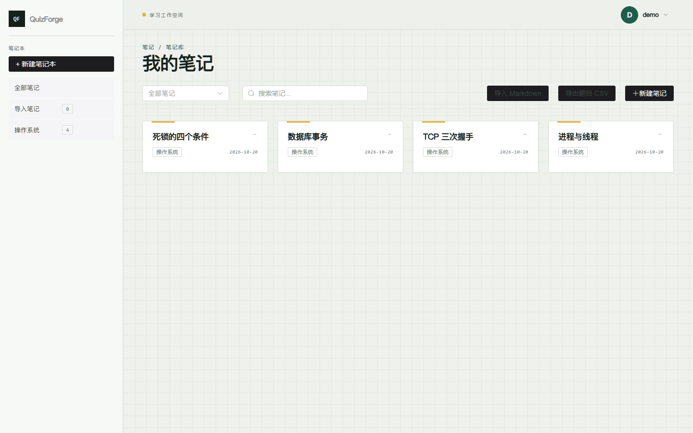
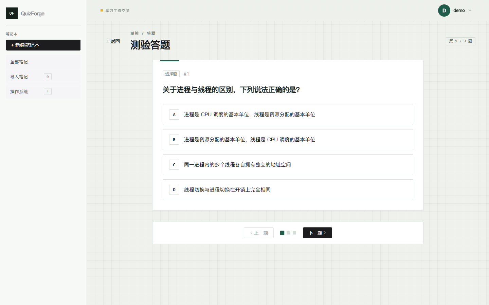
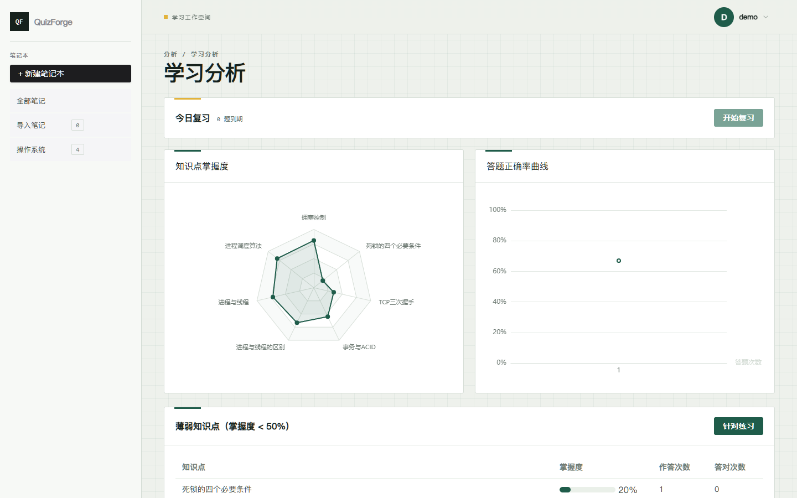
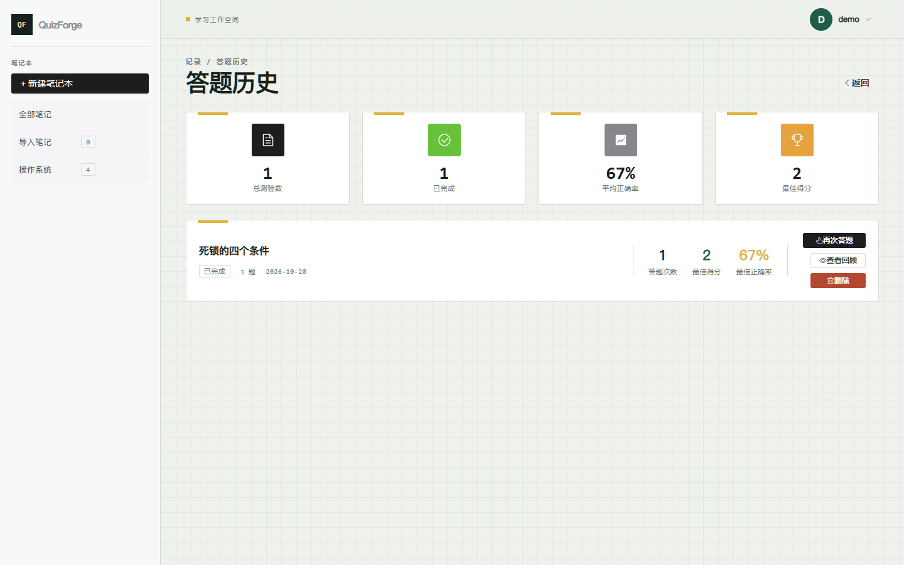
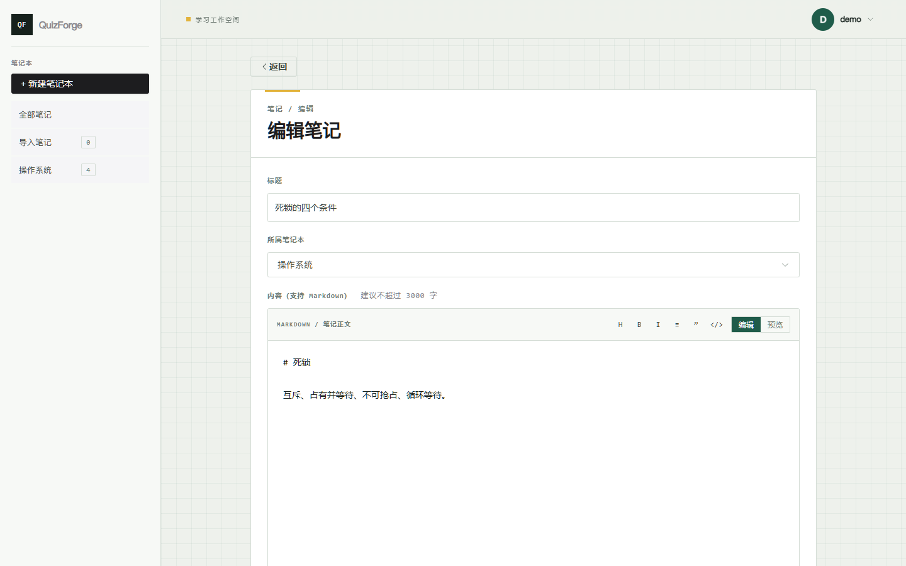
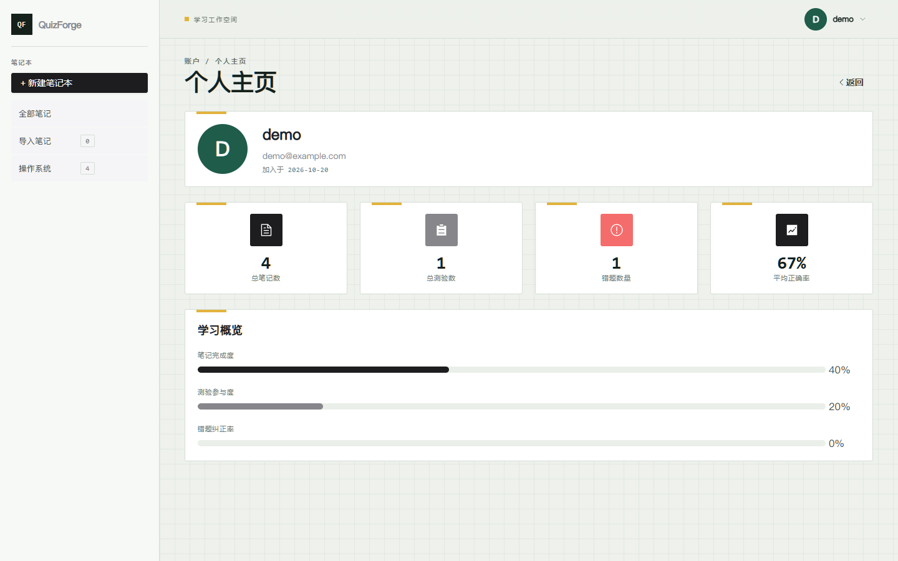
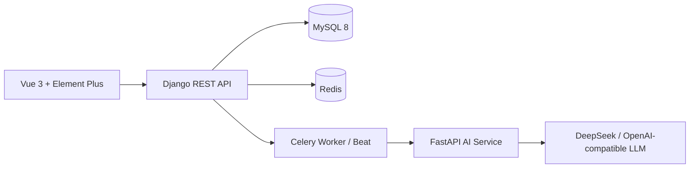

<div align="center">


# AiQuizForge

**Turn Markdown notes into adaptive quizzes — and actually remember them.**

Semantic chunking · question quality gates · BKT mastery · SM-2 spaced review · self-hosted

[](https://github.com/boluo140716/AiQuizForge-System)
[](https://github.com/boluo140716/AiQuizForge-System)
[](https://github.com/boluo140716/AiQuizForge-System)
[](https://github.com/boluo140716/AiQuizForge-System)
[](https://github.com/boluo140716/AiQuizForge-System)
[](https://github.com/boluo140716/AiQuizForge-System)
[](https://github.com/boluo140716/AiQuizForge-System)
[](LICENSE)

**English** | [简体中文](README.zh-CN.md)

</div>

---

## Why AiQuizForge?

Most AI quiz tools stop at “generate questions”. AiQuizForge closes the learning loop:

1. **Write** a Markdown note.
2. **Generate** a quiz with semantic chunking and question-quality gates.
3. **Answer** and update a Bayesian Knowledge Tracing (BKT) mastery estimate for each knowledge point.
4. **Practice** adaptively at the edge of your ability (Zone of Proximal Development).
5. **Review** with SM-2 spaced repetition before you forget.

## Screenshots

| Notes workspace | AI-generated quiz |
|:---:|:---:|
|  |  |

| Learning analytics | Answer history |
|:---:|:---:|
|  |  |

| Markdown editor | Profile |
|:---:|:---:|
|  |  |

## Features

### Learning loop
- **Markdown-first notes** — single-column editor with edit/preview toggle and word count.
- **Long-note generation** — semantic chunking + concurrent Map-Reduce, 1–10 single-choice questions.
- **Question quality gate** — structural validation, duplicate/all-of-the-above/similar options, stem-equals-option, similarity dedupe.
- **Knowledge points & BKT** — automatic KP extraction, question tagging, per-KP mastery.
- **Adaptive practice** — ZPD selection with a coverage reward, across notes and notebooks.
- **SM-2 review** — due queue, review quizzes, and scheduling.
- **Learning analytics** — KP radar, accuracy curve, weak-point table, targeted practice.
- **Interoperability** — import Markdown/TXT, export questions to CSV.

### Engineering
- **Reliable async generation** — Celery + Redis, idempotency keys, exponential backoff with jitter, DLQ (`failed_task`), stuck-task watchdog, SSE progress.
- **Shared state** — Redis-backed cache and rate limiting, safe across multiple API replicas.
- **Observability** — `/health/`, Prometheus `/metrics/`, optional Prometheus + Grafana stack.
- **Tests** — 39 Django tests, AI-side chunking/quality tests, query-count regression tests.

## Architecture



| Layer | Stack |
|---|---|
| Frontend | Vue 3.5, Vite, Element Plus, Pinia, ECharts |
| Backend | Django 5.2, DRF, SimpleJWT, Celery, Redis |
| Database | MySQL 8.0 |
| AI service | FastAPI, OpenAI SDK, semantic chunking + quality gate |
| Infra | Docker Compose, Nginx, Prometheus, Grafana |

## Quick start

**Requirements:** Docker Desktop + Docker Compose v2.

```bash
git clone https://github.com/boluo140716/AiQuizForge-System.git
cd AiQuizForge-System

# 1. Configure the AI service
cp ai_service/.env.example ai_service/.env
# edit ai_service/.env and set LLM_API_KEY, LLM_BASE_URL, LLM_MODEL

# 2. Start everything
docker compose up -d --build
```

Open **http://localhost:3000**.

### Demo account

```bash
docker compose exec backend python scripts/seed_demo.py
```

Then sign in with **`demo` / `demo12345`**.

### Environment variables

| Variable | Where | Description |
|---|---|---|
| `LLM_API_KEY` | `ai_service/.env` | API key for an OpenAI-compatible provider |
| `LLM_BASE_URL` | `ai_service/.env` | e.g. `https://api.deepseek.com/v1` |
| `LLM_MODEL` | `ai_service/.env` | e.g. `deepseek-chat` |
| `USE_MOCK` | `ai_service/.env` | `true` to skip LLM calls during development |
| `INTERNAL_TOKEN` | `ai_service/.env` | Must match `AI_SERVICE_TOKEN` in `docker-compose.yml` |

> **Security:** the default database/Redis passwords and internal token in `docker-compose.yml` are for local development. Change them before exposing the service publicly.

## Testing

```bash
# Backend (Linux/macOS)
docker compose run --rm --no-deps --entrypoint python \
  -v "$(pwd)/backend:/app" backend manage.py test

# Backend (Windows PowerShell)
docker compose run --rm --no-deps --entrypoint python `
  -v "D:/path/to/AiQuizForge-System/backend:/app" backend manage.py test

# AI-side chunking + quality tests
docker compose exec ai-service python tests/test_quality.py
```

## Observability

```bash
docker compose --profile monitoring up -d prometheus grafana
```

| Endpoint | URL |
|---|---|
| Health check | http://localhost:8000/health/ |
| Prometheus metrics | http://localhost:8000/metrics/ |
| Prometheus UI | http://localhost:9090 |
| Grafana | http://localhost:3001 (`admin` / `admin`) |

The Grafana datasource and the **QuizForge Overview** dashboard are provisioned automatically from `monitoring/`.

## Project structure

```
AiQuizForge-System/
├── backend/            # Django REST API, BKT, adaptive selection, SM-2, Celery
├── frontend/           # Vue 3 SPA, Element Plus, ECharts
├── ai_service/         # FastAPI + LLM prompt/chunking/quality pipeline
├── monitoring/         # Prometheus + Grafana provisioning
├── assets/             # README logo and screenshots
├── docker-compose.yml
└── README.md
```

## License

MIT — see [LICENSE](LICENSE).
