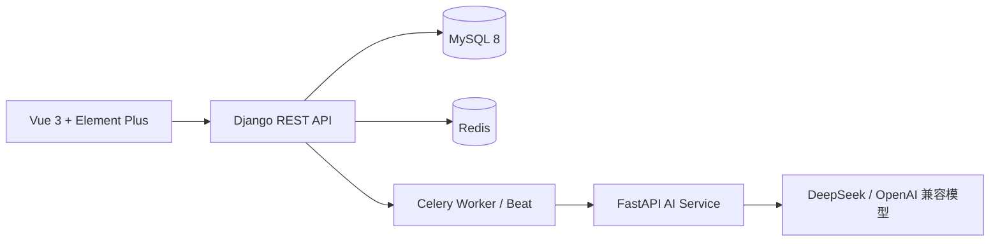

<div align="center">


# AiQuizForge

**把 Markdown 笔记变成自适应测验，并真正记住它们。**

语义分块 · 题目质量门控 · BKT 掌握度 · SM-2 间隔复习 · 可私有化部署

[](https://github.com/boluo140716/AiQuizForge-System)
[](https://github.com/boluo140716/AiQuizForge-System)
[](https://github.com/boluo140716/AiQuizForge-System)
[](https://github.com/boluo140716/AiQuizForge-System)
[](https://github.com/boluo140716/AiQuizForge-System)
[](https://github.com/boluo140716/AiQuizForge-System)
[](https://github.com/boluo140716/AiQuizForge-System)
[](LICENSE)

[English](README.md) | **简体中文**

</div>

---

## 为什么是 AiQuizForge？

大多数 AI 出题工具停在“生成题目”。AiQuizForge 把学习闭环补全：

1. **写**：用 Markdown 记录笔记。
2. **出题**：语义分块 + 题目质量门控，生成选择题。
3. **答题**：答完后用 BKT 更新每个知识点的掌握度。
4. **练习**：按最近发展区（ZPD）自适应选题。
5. **复习**：用 SM-2 在遗忘前安排复习。

## 项目截图

| 笔记工作台 | AI 生成测验 |
|:---:|:---:|
|  |  |

| 学习分析 | 答题历史 |
|:---:|:---:|
|  |  |

| Markdown 编辑器 | 个人主页 |
|:---:|:---:|
|  |  |

## 功能

### 学习闭环
- **Markdown 笔记**：单栏编辑器，支持编辑/预览切换与字数统计。
- **长笔记出题**：语义分块 + 并发 Map-Reduce，一次生成 1–10 道单选题。
- **题目质量门控**：结构校验、重复选项、万能选项、相似选项、题干等于选项、相似度去重。
- **知识点与 BKT**：自动抽取知识点、题目打标签、按知识点维护掌握度。
- **自适应练习**：ZPD 选题 + 覆盖奖励，支持跨笔记、跨笔记本组卷。
- **SM-2 复习**：到期队列、复习卷、复习排程。
- **学习分析**：知识点雷达图、正确率曲线、薄弱点表、针对练习。
- **互操作**：导入 Markdown/TXT，导出题目 CSV。

### 工程能力
- **可靠的异步生成**：Celery + Redis、幂等键、指数退避 + 抖动、失败任务 DLQ（`failed_task`）、僵死任务看门狗、SSE 实时进度。
- **共享状态**：Redis 缓存与限流，多 API 副本下保持一致。
- **可观测性**：`/health/`、Prometheus `/metrics/`，可选 Prometheus + Grafana。
- **测试**：39 个 Django 测试、AI 侧分块/质量测试、查询数回归测试。

## 系统架构



| 层级 | 技术 |
|---|---|
| 前端 | Vue 3.5、Vite、Element Plus、Pinia、ECharts |
| 后端 | Django 5.2、DRF、SimpleJWT、Celery、Redis |
| 数据库 | MySQL 8.0 |
| AI 服务 | FastAPI、OpenAI SDK、语义分块 + 质量门控 |
| 基础设施 | Docker Compose、Nginx、Prometheus、Grafana |

## 快速开始

**环境要求**：Docker Desktop + Docker Compose v2。

```bash
git clone https://github.com/boluo140716/AiQuizForge-System.git
cd AiQuizForge-System

# 1. 配置 AI 服务
cp ai_service/.env.example ai_service/.env
# 编辑 ai_service/.env，填写 LLM_API_KEY、LLM_BASE_URL、LLM_MODEL

# 2. 启动全部服务
docker compose up -d --build
```

打开 **http://localhost:3000**。

### 演示账号

```bash
docker compose exec backend python scripts/seed_demo.py
```

然后使用 **`demo` / `demo12345`** 登录。

### 环境变量

| 变量 | 位置 | 说明 |
|---|---|---|
| `LLM_API_KEY` | `ai_service/.env` | OpenAI 兼容服务的 API Key |
| `LLM_BASE_URL` | `ai_service/.env` | 例如 `https://api.deepseek.com/v1` |
| `LLM_MODEL` | `ai_service/.env` | 例如 `deepseek-chat` |
| `USE_MOCK` | `ai_service/.env` | 开发时可设为 `true`，跳过真实 LLM 调用 |
| `INTERNAL_TOKEN` | `ai_service/.env` | 必须与 `docker-compose.yml` 中的 `AI_SERVICE_TOKEN` 一致 |

> **安全提示**：`docker-compose.yml` 里的数据库/Redis 密码和内部 Token 是本地开发默认值，公网部署前请修改。

## 测试

```bash
# 后端（Linux/macOS）
docker compose run --rm --no-deps --entrypoint python \
  -v "$(pwd)/backend:/app" backend manage.py test

# 后端（Windows PowerShell）
docker compose run --rm --no-deps --entrypoint python `
  -v "D:/path/to/AiQuizForge-System/backend:/app" backend manage.py test

# AI 侧分块 + 质量测试
docker compose exec ai-service python tests/test_quality.py
```

## 可观测性

```bash
docker compose --profile monitoring up -d prometheus grafana
```

| 端点 | 地址 |
|---|---|
| 健康检查 | http://localhost:8000/health/ |
| Prometheus 指标 | http://localhost:8000/metrics/ |
| Prometheus UI | http://localhost:9090 |
| Grafana | http://localhost:3001（`admin` / `admin`） |

Grafana 数据源和 **QuizForge Overview** 看板由 `monitoring/` 自动配置。

## 项目结构

```
AiQuizForge-System/
├── backend/            # Django REST API、BKT、自适应选题、SM-2、Celery
├── frontend/           # Vue 3 SPA、Element Plus、ECharts
├── ai_service/         # FastAPI + LLM 提示词/分块/质量管线
├── monitoring/         # Prometheus + Grafana 配置
├── assets/             # README logo 与项目截图
├── docker-compose.yml
└── README.md
```

## 许可证

MIT — 见 [LICENSE](LICENSE)。
